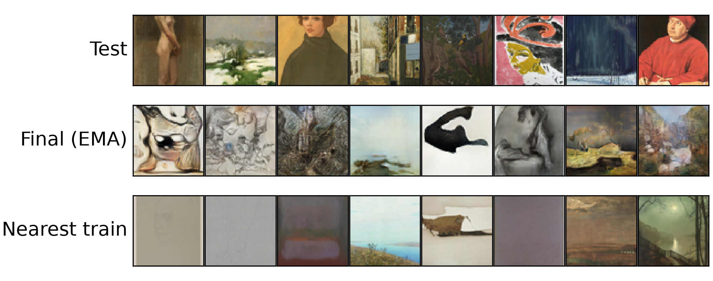
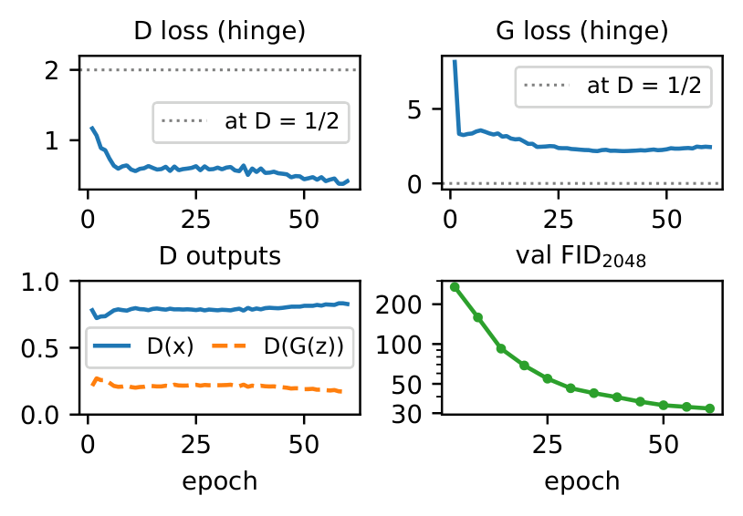

# ECE 285 HW2: Generating Paintings with a GAN

Code for the Homework 2 report of ECE 285 Deep Generative Models (UC San Diego, Fall 2026),
by Florian Saewert (Technical University of Munich). Python 3.12 + PyTorch, managed by
[uv](https://docs.astral.sh/uv/).

## Results at a glance

A DCGAN trained on 64 x 64 WikiArt paintings (60,271 training paintings, 27 styles, one
unconditional model). The final model (hinge loss, horizontal flips, width 128, 60 epochs,
EMA of the weights) reaches a **test FID-2048 of 20.8 +- 0.4** over three training seeds
(real paintings: 3.9; non-saturating base: 41.6) and an **Inception Score of 2.97** (real: 4.07).
The minimax game dies in its first epoch, as the saturation argument predicts.



*Seed-0 codes, nothing picked. Top: test paintings. Middle: new samples of the final model
(EMA weights). Bottom: the nearest training painting of each sample (pixel MSE): no obvious copies.*



*Training curves of the final model (seed 0, epoch means; validation FID on 2,000 paintings).
The FID still falls at epoch 60; after epoch 40, the discriminator pulls ahead.*

All runs and their scores: [`homeworks/hw2/results/results_table.tex`](homeworks/hw2/results/results_table.tex)
and one folder per run in [`homeworks/hw2/results/`](homeworks/hw2/results/).

## Where to look

| What | File |
|---|---|
| GAN: generator, discriminator, DCGAN initialization, sampling | [`homeworks/hw2/models/gan.py`](homeworks/hw2/models/gan.py) |
| Losses: minimax, non-saturating, hinge (from the logits) | [`homeworks/hw2/losses.py`](homeworks/hw2/losses.py) |
| One round of the game: `discriminator_step`, `generator_step` | [`homeworks/hw2/train.py`](homeworks/hw2/train.py) |
| All experiments of the report: sanity checks, the grids L / T / R / A, the final model (3 seeds), test FID / IS, table and figures (sections 7-18) | [`homeworks/hw2/notebooks/02_gan_step_by_step.ipynb`](homeworks/hw2/notebooks/02_gan_step_by_step.ipynb) |
| Settings with defaults; the reported `final` configuration | [`homeworks/hw2/config.py`](homeworks/hw2/config.py), [`homeworks/hw2/configs/final.yaml`](homeworks/hw2/configs/final.yaml) |
| Training loop (EMA, dead-game stop, TensorBoard + CSV logs, checkpoints, validation FID) | [`homeworks/hw2/train.py`](homeworks/hw2/train.py) |
| FID and Inception Score, as in the course's Ignite tutorial | [`src/dgm/evaluation/metrics.py`](src/dgm/evaluation/metrics.py), [`homeworks/hw2/evaluate.py`](homeworks/hw2/evaluate.py) |
| Data: WikiArt download, splits, cached 64 px arrays | [`src/dgm/data/wikiart.py`](src/dgm/data/wikiart.py) |
| Numbers behind the report's table: one folder per run (config, metrics per epoch, summary, test scores, D outputs); `final` = mean of the three `f-final-seed*` folders | [`homeworks/hw2/results/`](homeworks/hw2/results/) |
| The decisions of the grids and the validation real-data floor | [`results/f_setting.json`](homeworks/hw2/results/f_setting.json), [`results/real_val_fid_n2000.json`](homeworks/hw2/results/real_val_fid_n2000.json) |

Notebook outputs are stripped. In `eval/metrics.json` of a run, the `std` is over 3 sampling
repeats; the report's `final` row gives the mean and std over the 3 training seeds.

## Reproduce

Needs Python 3.12 and uv. A CUDA GPU is used if present.

```bash
git clone https://github.com/Florian2142/ece285-dgm-hw2.git
cd ece285-dgm-hw2
uv sync                                             # environment from uv.lock
uv run pytest -m "not slow"                         # tests (synthetic data)
uv run python -m dgm.data.wikiart --sizes 64        # data: 33.7 GB download, no Kaggle login
```

To reproduce the report's experiments, run
`homeworks/hw2/notebooks/02_gan_step_by_step.ipynb` from the top with `QUICK = False`
(sections 12-16 train the grids and the final model; sections 17-18 score them and make the
table and figures). A fresh clone must train the runs because checkpoints are not committed.

For one training run of the reported model from the command line:

```bash
uv run python -m hw2.train --config homeworks/hw2/configs/final.yaml          # seed 0
uv run python -m hw2.train --config homeworks/hw2/configs/final.yaml train.seed=1
uv run python -m hw2.evaluate                       # FID-10k / IS of the newest run
```

GPU training is not bit-wise deterministic: two otherwise matched runs reached validation
FIDs of 53.8 and 47.1 at epoch 30 (see the report).

## Use of AI

<!-- DRAFT: Florian, check every sentence and rewrite it in your own words. Claim only what is true. -->

I implemented the core of the GAN myself: the generator and discriminator architectures, the
DCGAN weight initialization and sampling in `models/gan.py`, the three losses in `losses.py`,
and one round of the game (`discriminator_step`, `generator_step`) in `train.py`.

I decided which experiments to run: the version of the game, longer training, the balance of
the two players, and the width of the networks. I did not write the code for these
experiments: the experiment tooling in the notebook (grids, decision rules, tables, figures)
was written with AI. AI also wrote the supporting code: data processing, the training loop
around my two steps (logging, checkpoints, EMA, the dead-game stop), the FID / IS evaluation,
and the tests. AI also helped draft and revise the report.

## Layout

```
src/dgm/                  shared library: data, training, evaluation (FID / IS), utils
homeworks/hw2/            package `hw2`: model, losses, training, evaluation, configs, notebooks, tests
homeworks/hw2/results/    numbers and figures behind the report
tests/                    tests of the shared library
```
